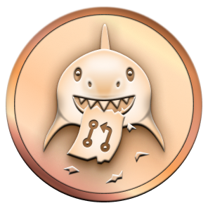

<p align="center">
  
</p>

<p align="center">
  <a href="https://jo-oladele.vercel.app">
    
  </a>
</p>

<p align="center">
  <a href="https://jo-oladele.vercel.app"></a>
  <a href="mailto:josepholadele001@gmail.com"></a>
  
</p>

---

## 👋 About me

I'm a full-stack engineer. Most days that means React and TypeScript on the front, Node.js or NestJS behind it, and Postgres underneath, with Rust, Python, Java and Go when the job calls for them. I like the part of the job where an interface stops feeling like a form and starts feeling like a product, and I like it more when the code behind it is boring to maintain.

Outside client work I contribute to open source: **35+ merged pull requests across 24 repositories** in the last year, mostly frontend, API and tooling work.

```ts
const joseph = {
  role: "Full-Stack Software Engineer",
  frontend: ["React", "Next.js", "TypeScript", "Tailwind", "GSAP"],
  backend: ["Node.js", "NestJS", "Prisma", "PostgreSQL", "MongoDB"],
  languages: ["TypeScript", "JavaScript", "Rust", "Python", "Java", "Go"],
  tooling: ["Docker", "GitHub Actions", "Vite", "Vercel"],
  currently: "shipping open-source tools and polished web apps",
};
```

---

## 🛠️ Tech stack

<p align="center">
  <a href="https://skillicons.dev">
    
  </a>
</p>

---

## 🚀 Featured work

<table>
  <tr>
    <td width="50%" valign="top">
      <h3><a href="https://github.com/JosephOladele/balin">Balin</a></h3>
      <p>An immersive one-page digital fashion house. Scroll-scrubbed reveals, a pinned horizontal lookbook and editorial typography, driven by GSAP and Lenis smooth scrolling.</p>
      <p>
        
        
        
        
      </p>
      <a href="https://balin-two.vercel.app"><b>▶ Live demo</b></a> &nbsp;·&nbsp; <a href="https://github.com/JosephOladele/balin">Source</a>
    </td>
    <td width="50%" valign="top">
      <h3><a href="https://github.com/JosephOladele/petal-chat-app">Petal Chat</a></h3>
      <p>A fully designed chat interface: sidebar, conversations, avatars, unread badges and animated read receipts, all in a soft pink theme.</p>
      <p>
        
        
        
      </p>
      <a href="https://petal-chat-app.vercel.app"><b>▶ Live demo</b></a> &nbsp;·&nbsp; <a href="https://github.com/JosephOladele/petal-chat-app">Source</a>
    </td>
  </tr>
</table>

---

## 🏆 Achievements

<p align="center">
  <a href="https://github.com/JosephOladele?tab=achievements"></a>
  &nbsp;&nbsp;
  <a href="https://github.com/JosephOladele?tab=achievements"></a>
  &nbsp;&nbsp;
  <a href="https://github.com/JosephOladele?tab=achievements"></a>
</p>

<p align="center">
  <b>Pull Shark ×2</b> &nbsp;·&nbsp; <b>Pair Extraordinaire ×2</b> &nbsp;·&nbsp; <b>Quickdraw ×2</b>
</p>

<p align="center">
  
  
  
</p>

### Open-source contributions

<p align="center">
  <a href="https://github.com/C-Address-Onboarding-Bridge/C-Address-Onboarding-Bridge--Frontend-"></a>
  <a href="https://github.com/Hub-of-Evolution/CraftNexus"></a>
  <a href="https://github.com/LightForgeHub/SkillSphere-Dapp"></a>
  <a href="https://github.com/CalloraOrg/Callora-Frontend"></a>
  <a href="https://github.com/Disciplr-Org/Disciplr-backend"></a>
  <a href="https://github.com/StellarFraction/StellarFraction-frontend"></a>
  <a href="https://github.com/soroban-forge-labs/soroban-lens"></a>
</p>

---

## 📊 GitHub stats

<p align="center">
  
  
</p>
<p align="center">
  
</p>

<p align="center">
  <picture>
    <source media="(prefers-color-scheme: dark)" srcset="https://raw.githubusercontent.com/JosephOladele/JosephOladele/output/github-contribution-grid-snake-dark.svg" />
    <source media="(prefers-color-scheme: light)" srcset="https://raw.githubusercontent.com/JosephOladele/JosephOladele/output/github-contribution-grid-snake.svg" />
    
  </picture>
</p>

---

## ⚡ Recent activity

<!--START_SECTION:activity-->
1. ⬆️ Pushed to [soroban-forge-labs/soroban-lens](https://github.com/soroban-forge-labs/soroban-lens)
2. ⬆️ Pushed to [soroban-forge-labs/soroban-forge](https://github.com/soroban-forge-labs/soroban-forge)
3. 💪 Opened PR [#410](https://github.com/Stellar-songifi/Lyricsflip_server/pull/410) in [Stellar-songifi/Lyricsflip_server](https://github.com/Stellar-songifi/Lyricsflip_server)
4. 🎉 Merged PR [#961](https://github.com/C-Address-Onboarding-Bridge/C-Address-Onboarding-Bridge--Frontend-/pull/961) in [C-Address-Onboarding-Bridge/C-Address-Onboarding-Bridge--Frontend-](https://github.com/C-Address-Onboarding-Bridge/C-Address-Onboarding-Bridge--Frontend-)
5. 🎉 Merged PR [#314](https://github.com/progidyken-hub/BLUEWHALE/pull/314) in [progidyken-hub/BLUEWHALE](https://github.com/progidyken-hub/BLUEWHALE)
<!--END_SECTION:activity-->

---

<p align="center">
  <i>"Clean code always looks like it was written by someone who cares."</i>
</p>

<p align="center">
  
</p>
